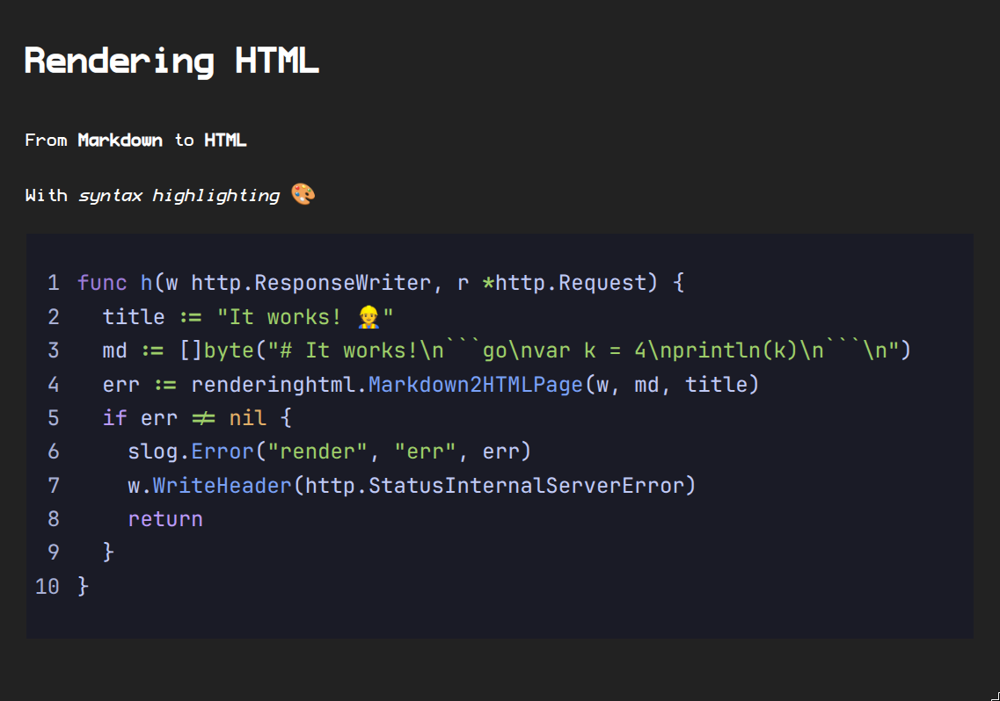

# Rendering HTML

From **Markdown** to **HTML**

With *syntax highlighting* 🎨

```go
func h(w http.ResponseWriter, r *http.Request) {
  title := "It works! 👷"
  md := []byte("# It works!\n```go\nvar k = 4\nprintln(k)\n```\n")
  err := renderinghtml.Markdown2HTMLPage(w, md, title)
  if err != nil {
    slog.Error("render", "err", err)
    w.WriteHeader(http.StatusInternalServerError)
    return
  }
}
```

If you are seeing this in your web browser, try visiting the [test](TEST.html) page.

---

## Screenshot



## Features

- Markdown Rendering
- Syntax Highlighting
- Minify CSS/JS/HTML

## Code

```bash
echo "hello world"
```

```go
package main
import "fmt"
func main() {
    fmt.Println("hello world")
}
```

```js
console.log("hello world");
```

```c
#include <stdio.h>
int main() {
    printf("hello world\n");
    return 0;
}
```

```sql
SELECT * FROM users WHERE id = 1;
```


## Commands

Included is a basic markdown2html command

```bash
markdown2html README.md
# Outputs:
# /tmp/markdown2html_README.html
```

```bash
# open browser
xdg-open file:///$(markdown2html README.md)
```
